# Vaishnavi Amruthala

**Business Intelligence Analyst · Business Analyst**

## About Me

Hi, I’m Vaishnavi, a BI and Business Analyst focused on healthcare and operations.  
I turn complex data into trusted KPIs, clear dashboards, and practical recommendations.

Connect with me on <a href="https://www.linkedin.com/in/vaishnaviamruthala">💼 LinkedIn</a>&nbsp;&nbsp;&nbsp;&nbsp;<a href="mailto:vaishnaviamruthala@gmail.com">✉️ Email</a>&nbsp;&nbsp;&nbsp;&nbsp;<a href="https://public.tableau.com/app/profile/vaishnavi.amruthala8328/vizzes">📊 Tableau Public</a>

[Featured work](#featured-work) · [How I work](#how-i-work) · [Toolkit](#toolkit) · [All repositories](https://github.com/vamruthala?tab=repositories)

## Featured work

<table>
<tr>
<td width="50%"> <strong><a href="https://github.com/vamruthala/clinical-data-quality-monitoring-management-system">Clinical Data Quality</a></strong> Multi-site clinical study monitoring across data streams. 5,324 checks · 94% completeness MS Access · Excel · Tableau</td>
<td width="50%"> <strong><a href="https://github.com/vamruthala/healthcare-analytics-dashboard">Healthcare Analytics</a></strong> Service volume, case mix, and length-of-stay dashboards. Excel · Tableau</td>
</tr>
<tr>
<td width="50%"> <strong><a href="https://github.com/vamruthala/local-cafe-six-sigma-operations-analytics">Six Sigma · Local Cafe</a></strong> DMAIC case study for service flow and wait-time analysis. Pareto · Fishbone · Hypothesis testing · Excel · JMP</td>
<td width="50%"> <strong><a href="https://github.com/vamruthala/inventory-restock-supply-chain-analytics">Inventory Restock</a></strong> Supply chain replenishment and stale-unit patterns. Tableau · Excel</td>
</tr>
<tr>
<td width="50%"> <strong><a href="https://github.com/vamruthala/sales-performance-analytics">Sales Performance</a></strong> Customer, product, category, and regional sales analysis. +26.97% year-over-year growth · Tableau · Excel</td>
<td width="50%"> <strong><a href="https://github.com/vamruthala/customer-churn-analysis">Customer Churn</a></strong> Churn pattern and driver analysis for retention questions. Nominal logistic regression · model evaluation · JMP</td>
</tr>
</table>

Cafe scenario figures are illustrative comparisons, not measured live results.

## How I work

## Toolkit

<table width="100%" border="0" cellpadding="8" cellspacing="8">
<tr>
<td width="33%" valign="top"><table width="100%" border="1" cellpadding="12" cellspacing="0" bordercolor="#d8e4d1"><tr><td valign="top" bgcolor="#fbfcf8"><strong>01 · Data Warehousing</strong> <small>DW</small>
 Snowflake  Google BigQuery  dbt</td></tr></table></td>
<td width="33%" valign="top"><table width="100%" border="1" cellpadding="12" cellspacing="0" bordercolor="#d8e4d1"><tr><td valign="top" bgcolor="#fbfcf8"><strong>02 · Business Intelligence</strong> <small>BI</small>
 Tableau  Power BI  Looker</td></tr></table></td>
<td width="33%" valign="top"><table width="100%" border="1" cellpadding="12" cellspacing="0" bordercolor="#d8e4d1"><tr><td valign="top" bgcolor="#fbfcf8"><strong>03 · Programming &amp; Analytics</strong>
 Python ▣ SQL  R  Excel Σ Statistics</td></tr></table></td>
</tr>
<tr>
<td width="33%" valign="top"><table width="100%" border="1" cellpadding="12" cellspacing="0" bordercolor="#d8e4d1"><tr><td valign="top" bgcolor="#fbfcf8"><strong>04 · Databases</strong>
 PostgreSQL  MS Access  SQLite</td></tr></table></td>
<td width="33%" valign="top"><table width="100%" border="1" cellpadding="12" cellspacing="0" bordercolor="#d8e4d1"><tr><td valign="top" bgcolor="#fbfcf8"><strong>05 · Statistical Tools</strong>
<strong>SAS Viya</strong> <strong>JMP</strong></td></tr></table></td>
<td width="33%" valign="top"><table width="100%" border="1" cellpadding="12" cellspacing="0" bordercolor="#d8e4d1"><tr><td valign="top" bgcolor="#fbfcf8"><strong>06 · CRM &amp; Data Governance</strong>
 Salesforce  HubSpot  Airtable ✓ Data Quality ✓ Data Validation ✓ PII/PHI Data ✓ Data Compliance</td></tr></table></td>
</tr>
</table>

