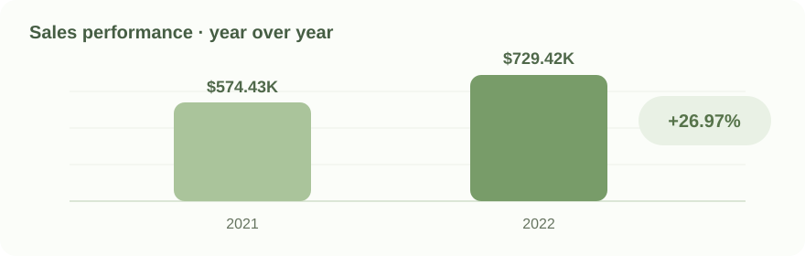

  

  

# Vaishnavi Amruthala

**Business Intelligence Analyst · Business Analyst**  
My work turns healthcare and operations questions into clear metrics, practical analysis, and recommendations teams can act on.

[Featured work](#featured-work) · [Toolkit](#toolkit) · [Activity](#github-activity) · [Repositories](https://github.com/vamruthala?tab=repositories)

## Featured work

<table>
  <tr>
    <td width="50%"><strong><a href="https://github.com/vamruthala/clinical-data-quality-monitoring-management-system">Clinical Data Quality</a></strong> Clinical study quality monitoring across four sites and multiple data streams. 5,324 checks · 94% completeness MS Access · Excel · Tableau</td>
    <td width="50%"><strong><a href="https://github.com/vamruthala/local-cafe-six-sigma-operations-analytics">Six Sigma · Local Cafe</a></strong> DMAIC case study for service flow, wait-time analysis, and practical process improvements. Pareto · Fishbone · Hypothesis testing Excel · JMP</td>
  </tr>
  <tr>
    <td width="50%"><strong><a href="https://github.com/vamruthala/inventory-restock-supply-chain-analytics">Inventory Restock</a></strong> Supply chain review of replenishment, stale units, machines, and daily patterns. Restock and stale-unit analysis Tableau · Excel</td>
    <td width="50%"><strong><a href="https://github.com/vamruthala/sales-performance-analytics">Sales Performance</a></strong> Customer, product, category, and regional sales analysis. +26.97% year-over-year sales growth Tableau · Excel</td>
  </tr>
  <tr>
    <td width="50%"><strong><a href="https://github.com/vamruthala/customer-segmentation-analysis">Customer Segmentation</a></strong> Spending-based profiles to support focused offer tests. 2 clusters · 2,240 customers Tableau</td>
    <td width="50%"><strong><a href="https://github.com/vamruthala/food-mart-marketing-campaign-cost-prediction">Campaign Cost Prediction</a></strong> SAS Viya model comparison and analysis of campaign cost drivers. Regression · Decision tree · Neural network SAS Viya</td>
  </tr>
</table>

## A project insight in one chart

*Year-over-year growth = (2022 sales − 2021 sales) ÷ 2021 sales × 100.*

## Toolkit

**Programming & analytics:** Python · SQL · Statistics  
**Business intelligence:** Tableau · Power BI · Looker · Excel  
**Warehousing & transformation:** Snowflake · BigQuery · dbt  
**Databases:** PostgreSQL · MS Access · SQLite  
**CRM & work management:** Salesforce · HubSpot · Airtable  
**Data quality & compliance:** Data quality · Data validation · PII/PHI data · Data compliance  
**Analytics platforms:** SAS Viya · JMP

  
  
  
  
  
  
  
  
  
  
  
  
  
  

## GitHub activity

  

  
  

[Browse all repositories](https://github.com/vamruthala?tab=repositories)

