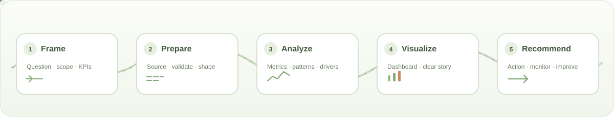

# Vaishnavi Amruthala

**Business Intelligence Analyst · Business Analyst**

## About Me

Hi, I’m Vaishnavi, a BI and Business Analyst focused on healthcare and operations.  
I work across research and industry settings, translating complex data into trusted KPIs, clear dashboards, and practical recommendations.

<strong>Connect with me</strong> 
&nbsp; <a href="https://www.linkedin.com/in/vaishnaviamruthala">LinkedIn</a> &nbsp;&nbsp;&nbsp;
&nbsp; <a href="mailto:vaishnaviamruthala@gmail.com">vaishnaviamruthala@gmail.com</a> &nbsp;&nbsp;&nbsp;
&nbsp; <a href="https://public.tableau.com/app/profile/vaishnavi.amruthala8328/vizzes">Tableau Public</a>

[Featured work](#featured-work) · [How I work](#how-i-work) · [Toolkit](#toolkit) · [All repositories](https://github.com/vamruthala?tab=repositories)

## Featured work

<table>
<tr>
<td width="50%"> <strong><a href="https://github.com/vamruthala/clinical-data-quality-monitoring-management-system">Clinical Data Quality</a></strong> Multi-site clinical study monitoring across data streams. 5,324 checks · 94% completeness MS Access · Excel · Tableau</td>
<td width="50%"> <strong><a href="https://github.com/vamruthala/healthcare-analytics-dashboard">Healthcare Analytics</a></strong> Service volume, case mix, and length-of-stay dashboards. Excel · Tableau</td>
</tr>
<tr>
<td width="50%"> <strong><a href="https://github.com/vamruthala/local-cafe-six-sigma-operations-analytics">Six Sigma · Local Cafe</a></strong> DMAIC case study for service flow and wait-time analysis. Pareto · Fishbone · Hypothesis testing · Excel · JMP</td>
<td width="50%"> <strong><a href="https://github.com/vamruthala/inventory-restock-supply-chain-analytics">Inventory Restock</a></strong> Supply chain replenishment and stale-unit patterns. Tableau · Excel</td>
</tr>
<tr>
<td width="50%"> <strong><a href="https://github.com/vamruthala/sales-performance-analytics">Sales Performance</a></strong> Customer, product, category, and regional sales analysis. +26.97% year-over-year growth · Tableau · Excel</td>
<td width="50%"> <strong><a href="https://github.com/vamruthala/customer-churn-analysis">Customer Churn</a></strong> Churn pattern and driver analysis for retention questions. Nominal logistic regression · model evaluation · JMP</td>
</tr>
</table>

Cafe scenario figures are illustrative comparisons, not measured live results.

## How I work

## Toolkit

### Technical Toolkit

**Data Warehousing:** Snowflake · Google BigQuery · dbt

**Business Intelligence:** Tableau · Power BI · Looker

**Programming & Analytics:** Python · SQL · R · Excel

**Databases:** PostgreSQL · MS Access · SQLite

**Statistical Tools:** SAS Viya · JMP

**CRM:** Salesforce · HubSpot · Airtable

**Data Governance:** Data Quality · Data Validation · Data Compliance

<table width="100%" border="0" cellpadding="7" cellspacing="6">
<tr><td width="25%" align="center"></td><td width="25%" align="center"></td><td width="25%" align="center"></td><td width="25%" align="center"></td></tr>
<tr><td width="25%" align="center"></td><td width="25%" align="center"></td><td width="25%" align="center"></td><td width="25%" align="center"></td></tr>
</table>

Also: R, Statistics, BigQuery, Looker, PostgreSQL, MS Access, SQLite, JMP, Salesforce, HubSpot, Airtable, data quality, data validation, PII/PHI data, and data compliance.

