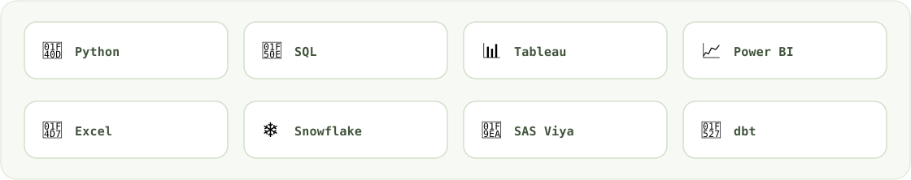

# <code>Vaishnavi Amruthala</code>

**<code>Business Intelligence Analyst · Business Analyst</code>**

## <code>About Me</code>

<code>Hi, I’m Vaishnavi, a BI and Business Analyst focused on healthcare and operations.</code>  
<code>I turn complex data into trusted KPIs, clear dashboards, and practical recommendations.</code>

<code>Connect with me on</code> <a href="https://www.linkedin.com/in/vaishnaviamruthala">💼 <code>LinkedIn</code></a>&nbsp;&nbsp;&nbsp;&nbsp;<a href="mailto:vaishnaviamruthala@gmail.com">✉️ <code>Email</code></a>&nbsp;&nbsp;&nbsp;&nbsp;<a href="https://public.tableau.com/app/profile/vaishnavi.amruthala8328/vizzes">📊 <code>Tableau Public</code></a>

[<code>Featured work</code>](#featured-work) · [<code>How I work</code>](#how-i-work) · [<code>Toolkit</code>](#toolkit) · [<code>All repositories</code>](https://github.com/vamruthala?tab=repositories)

## <code>Featured work</code>

<table>
<tr>
<td width="50%"> <strong><a href="https://github.com/vamruthala/clinical-data-quality-monitoring-management-system"><code>Clinical Data Quality</code></a></strong> <code>Multi-site clinical study monitoring across data streams.</code> <code>5,324 checks · 94% completeness MS Access · Excel · Tableau</code></td>
<td width="50%"> <strong><a href="https://github.com/vamruthala/healthcare-analytics-dashboard"><code>Healthcare Analytics</code></a></strong> <code>Service volume, case mix, and length-of-stay dashboards.</code> <code>Excel · Tableau</code></td>
</tr>
<tr>
<td width="50%"> <strong><a href="https://github.com/vamruthala/local-cafe-six-sigma-operations-analytics"><code>Six Sigma · Local Cafe</code></a></strong> <code>DMAIC case study for service flow and wait-time analysis.</code> <code>Pareto · Fishbone · Hypothesis testing · Excel · JMP</code></td>
<td width="50%"> <strong><a href="https://github.com/vamruthala/inventory-restock-supply-chain-analytics"><code>Inventory Restock</code></a></strong> <code>Supply chain replenishment and stale-unit patterns.</code> <code>Tableau · Excel</code></td>
</tr>
<tr>
<td width="50%"> <strong><a href="https://github.com/vamruthala/sales-performance-analytics"><code>Sales Performance</code></a></strong> <code>Customer, product, category, and regional sales analysis.</code> <code>+26.97% year-over-year growth · Tableau · Excel</code></td>
<td width="50%"> <strong><a href="https://github.com/vamruthala/customer-churn-analysis"><code>Customer Churn</code></a></strong> <code>Churn pattern and driver analysis for retention questions.</code> <code>Nominal logistic regression · model evaluation · JMP</code></td>
</tr>
</table>

<code>Cafe scenario figures are illustrative comparisons, not measured live results.</code>

## <code>How I work</code>

## <code>Toolkit</code>

<code>Analytics: Python · Statistics · SQL · Excel</code>  
<code>BI: Tableau · Power BI · Looker</code>  
<code>Data platforms: SAS Viya · JMP · Snowflake · BigQuery · dbt</code>  
<code>Databases: PostgreSQL · MS Access · SQLite</code>  
<code>CRM &amp; data trust: Salesforce · HubSpot · Airtable · Data Quality · Data Validation · PII/PHI · Data Compliance</code>

